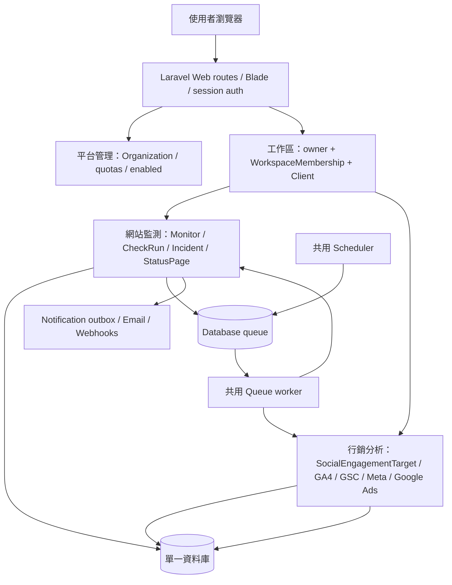
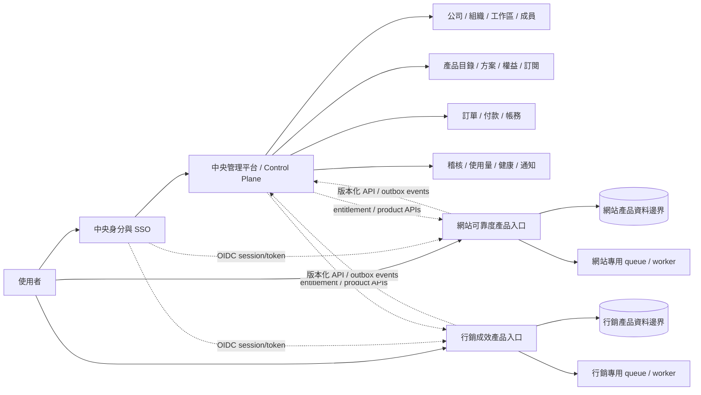

# 多產品 SaaS 中央管理平台：現況盤點與目標架構

**狀態：唯讀盤點與架構提案，待確認。** 多產品 SaaS 中央管理平台是本專案的長期目標；本階段只盤點現況並提出分階段方案，不修改程式碼或資料庫。待使用者確認方案及相關產品政策後，才進入實作規劃。

## 1. 決策摘要

目標是「中央控制平台 + 多個有清楚責任邊界的產品」，不是把所有產品業務塞進中央後台，也不要求立即拆成微服務。

建議先維持一個 Laravel 部署，逐步整理成模組化單體：中央層負責身分、組織、產品目錄、方案權益、帳務、稽核及平台健康；產品層保留各自的業務規則、資料、報表和工作。產品之間只能經由明確的共用服務、契約或事件交換資料，不直接讀取彼此的 Eloquent 模型。只有當部署、擴充或故障隔離需求已實際出現，才將個別產品獨立部署。

現有功能初步分成兩個有商業化可能的產品：

1. **網站可靠度監測**：網站可用性、TLS、DNS、網域到期、robots、事件、通知及公開狀態頁。
2. **行銷成效分析**：社群貼文公開互動、GA4、Google Search Console、Meta Ads、Google Ads、活動歸因、成效報表及客戶報告分享。

代理商工作區、成員、客戶主檔、登入、訂閱權益及付款應由中央共用能力提供。跨產品報告分享可共用權限、到期、撤銷與匯出機制，但各產品仍負責提供自己的報表資料。社群貼文追蹤和廣告平台連結目前先留在行銷成效產品內，不依現有選單或資料表數量硬拆成更多產品。

## 2. 目前架構盤點

### 2.1 執行形態

- Laravel 13.42.0；專案執行環境目標為 PHP 8.4。前端是 Blade/Vite。
- `routes/web.php` 是主要應用路由；`routes/console.php` 宣告排程。專案沒有 `routes/api.php`，目前沒有供第一方子平台使用的版本化 API。
- `compose.yaml` 定義一個 Laravel app、一個 MySQL 8.4、一個共用資料庫佇列 worker、一個 scheduler，以及一次性 migration 服務。網站監測與行銷同步共用同一個應用程式、資料庫及 worker 執行環境。
- 測試使用記憶體 SQLite。`php artisan migrate:status` 顯示目前本機資料庫的遷移皆已執行；這不等於 MySQL 8.4 或 Compose 部署驗收。
- 本機 Compose YAML 可解析，但盤點環境沒有 Docker CLI/daemon，因此映像建置、容器啟動及 MySQL 8.4 執行結果尚未驗證。



### 2.2 身分、租戶與權限

- `users` 是本機 email/password 帳號；登入、登出及密碼重設由 Laravel Web session 處理。目前沒有 OIDC 身分提供者、跨產品 SSO 或標準 access token。
- `is_platform_admin` 是使用者上的全域布林旗標。總管理介面可選擇組織進入該組織的工作區上下文。
- `organizations.owner_user_id` 唯一連到一個 owner 使用者；尚無可容納多家公司、多工作區或同一使用者跨多組織成員關係的正規租戶模型。
- `workspace_memberships.member_user_id` 唯一；目前一個會員使用者只能有一筆工作區會員關係。角色為 `editor` 或 `read_only`，客戶範圍由工作區層級設定。
- 目前「工作區」是由 owner 使用者及會員關係推導出來，資料庫沒有獨立 `workspaces` 表。`organizations` 與工作區在業務上近似一對一，但責任尚未拆清。
- `Client` 是代理商的外部客戶/品牌，並非 SaaS 租戶。它以 `user_id` 歸屬工作區 owner，再供監測項目、活動、平台帳號對應和報表分享使用。
- `AuthenticatedAccountScope`、`AuthenticatedRelationScope`、`WorkspaceClientScope` 等 Eloquent scopes 以 `user_id`、關聯和 client 範圍執行隔離。正式資料以 owner 使用者作為主要歸屬；測試環境另容許 ownerless fixture，不能拿該例外當正式隔離模型。

### 2.3 資料表和產品責任

現有資料集中在同一資料庫，主要資料群如下：

| 資料群 | 代表資料表 / 模型 | 目前歸屬方式 | 目標責任 |
| --- | --- | --- | --- |
| 身分與工作區 | `users`, `organizations`, `workspace_memberships`, `workspace_invitations`, `clients` | owner user ID；工作區由使用者關係推導 | 中央平台：全域身分、組織、工作區、成員及客戶主檔 |
| 網站可靠度 | `monitors`, `check_runs`, `incidents`, `incident_events`, `maintenance_windows`, `tls_observations`, `dns_change_events`, `robots_observations`, `status_pages` | `user_id`、`client_id` 或 monitor 關聯 | 網站可靠度產品擁有業務資料；通知投遞底層可共用 |
| 行銷活動與公開貼文 | `social_engagement_targets`, `check_runs` 社群監測欄位、貼文及活動報表/快照 | `user_id`、`client_id`、平台欄位 | 行銷成效產品；不依 Facebook、Instagram、Threads 拆成獨立產品 |
| 外部分析與廣告連線 | `google_analytics_connections`, `google_search_console_connections`, `meta_marketing_connections`, `google_ads_connections` 及 per-client property/account 對應 | 連線以 owner user ID；各客戶另綁 property/site/ad account | 行銷產品的連接器模組；憑證設定服務可共用 |
| 報表與分享 | `client_report_shares`, `client_report_snapshots`, `client_report_templates`, `client_exchange_rates` | 分享連到 client，快照連到分享 | 分享連結、撤銷、期限、匯出可共用；報表資料由各產品提供 |
| 通知與背景工作 | `notification_outbox`, `jobs`, `failed_jobs`, `scheduler_heartbeats` | 通知多由 incident/monitor 關聯；佇列共用 | 通知、outbox、健康度是共用執行服務；事件來源及處理規則由產品擁有 |

### 2.4 整合憑證現況

目前有兩種不同憑證，不應混為一談：

- 每個工作區 owner 透過平台 OAuth 流程授權自己的 Google/Meta 帳戶。refresh/access token 存在各連線資料表，模型使用 Laravel `encrypted` cast；Google Ads/Meta 模型也隱藏 token 序列化欄位。
- GA4 與 Google Search Console connection model 目前沒有宣告隱藏 refresh token 的序列化欄位。因現有產品尚無第一方 API，盤點未確認目前有外洩路徑；未來建立 API/resource 前，必須先補隱藏欄位和 serialization 測試。
- OAuth provider app 的 `client_id`、`client_secret` 和 callback URI 目前讀自 `.env` / `config/services.php`。Google Ads 與 Meta 連線頁明確提示由伺服器環境設定。這與「使用者自行在平台填寫」的目標不同。

本提案以使用者最新要求為準：目標設計應允許工作區管理者在整合設定頁輸入其 provider app 的 client ID/secret，再由該工作區進行 OAuth。這和使用者授權後產生的 access/refresh token 是不同記錄，必須分表/分欄管理。provider secret 必須加密、更新後不回顯、限制讀取權限並記錄異動；不得進 log、URL 或前端腳本。`APP_KEY` 仍是站台層級加密根金鑰，不能改由每個整合帳號填入。

### 2.5 路由、API、排程與測試證據

- 平台管理、會員邀請、客戶、整合設定、監測、報表和匯出目前都是同一組登入後 Web routes；不同路徑由 `EnsurePlatformAdmin`、`EnsureWorkspaceOwner`、`RejectReadOnlyWorkspaceMemberWrites` 及相關 scopes 控制。
- GA4、Meta Ads、Google Ads、Google Search Console 是呼叫外部 provider 的連接器，不是內部產品 API。`routes` 目前只有 Web 與 Console 路由檔。
- 排程器每分鐘派送網站監測與 worker heartbeat，另排每日 TLS、網域、robots、DNS 摘要及行銷資料同步。所有工作目前共用同一資料庫佇列，產品間沒有 worker/queue 邊界。
- `AgencyWorkflowAcceptanceTest` 建立兩個組織、不同成員角色、多個客戶，並檢查 GA4 帳號對應、報表、CSV 匯出及分享內容隔離。它以 HTTP fake 驗證應用程式流程，不是 Google 實際 OAuth/API 驗收。
- `AccountDataIsolationTest`、`ClientReportShareTest`、`ClientReportSnapshotControllerTest`、`CommercialUsageLimitTest`、`PlatformOrganizationTest` 等測試涵蓋資料隔離、權限、匯出、分享與配額；整合 provider 目前缺少正式憑證時，外部服務仍須另行實際驗證。

## 3. 功能分類

### 3.1 應由中央平台管理的共用核心

| 能力 | 現況 | 中央平台目標責任 |
| --- | --- | --- |
| 全域身分 | 本機 `users`、session login；無 SSO | 全域唯一 subject、登入、SSO、帳號生命週期、MFA/安全政策 |
| 公司、組織、租戶、工作區 | `Organization` 綁單一 owner，工作區隱含於 owner | 公司/帳務主體、租戶、工作區及多對多會員關係明確化 |
| 全域角色 | `is_platform_admin`；工作區 `editor/read_only` | Super Admin、組織管理角色、產品管理角色與客戶範圍分離 |
| 產品註冊及開通 | 尚無產品目錄或產品啟用狀態 | 產品 catalog、產品狀態、組織訂閱某產品的啟用狀態 |
| 訂閱/方案/權益 | 只有組織層級的 `plan_name`、日期及席次/資源上限 | 產品方案、feature entitlement、用量、試用/付款/到期/取消 |
| 訂單、付款、帳務 | 平台沒有訂單、付款紀錄或發票資料 | 訂單項目、人工收款紀錄、退款/調整、對帳及財務匯出 |
| 稽核與營運 | scheduler/worker heartbeat 和產品事件紀錄零散 | 管理操作稽核、全域通知、產品健康、跨產品使用量/成本彙總 |
| 客戶主檔 | `clients` 是 workspace 下的代理商客戶，已有使用中 | 中央共用 CRM-lite 客戶主檔；保留產品特有映射在產品模組 |

### 3.2 可獨立商業化的子平台

1. **網站可靠度監測產品**：監測目標、HTTP/TLS/DNS/robots/網域資訊、事件與復原、維護時段、通知規則、網站公開狀態頁。
2. **行銷成效分析產品**：公開貼文互動監測、社群平台來源、GA4/GSC/Meta Ads/Google Ads 連線、活動指標、歸因、預算/ROAS 分析、產品報表。

兩者可以共用帳號、租戶、客戶、訂閱、事件投遞、匯出和報表分享能力；不需因為目前放在同一個 app 就融合成一個產品，也不需為每個資料來源建立獨立產品。

### 3.3 保留在特定產品的內部模組

- 網站產品：HTTP 與內容檢查、TLS、DNS 變更、domain expiry、robots、SLO/incident、maintenance、status page。
- 行銷產品：公開社群貼文擷取、GA4 渠道/事件/商品/landing page、Google Ads 活動/素材/裝置/競價、Meta Ads ad set/placement/demographics、貨幣與歸因分析。
- 報表頁內容由產品模組產生；共用報表服務只管理選取範圍、品牌、期限、分享 token、快照完整性及下載授權。

### 3.4 可由多個子平台共用的基礎服務

全域身分、組織/工作區、client 主檔、RBAC/授權、產品目錄、entitlement 查詢、credential vault、通知 outbox、佇列與排程管理、稽核、健康探測、檔案匯出/分享骨架及 API gateway/client registry。

### 3.5 尚未實作但目標架構必須具備

- 多組織/多工作區的正式租戶模型；使用者可加入多組織，且可在各產品有不同角色。
- 具產品識別碼、狀態和部署版本的產品目錄；產品和產品專屬 entitlement/plan 註冊契約。
- OIDC SSO issuer/client 流程；產品 audience 與 scope 的跨平台授權。
- 組織/工作區層級的使用者自填 OAuth app 憑證 UI、加密、輪替及稽核。
- 依產品授權的訂閱 item、方案/feature entitlement、用量 ledger 和跨產品 bundle。
- 訂單、人工付款紀錄、交易/退款/發票狀態及商業統計（MRR、ARR、續訂、流失）。
- 跨產品 API 使用量、資源消耗/成本歸屬；產品專屬 queue、worker、health 與錯誤隔離。
- 產品模組契約、版本相容性、事件 outbox/inbox 及未來獨立部署通訊介面。

## 4. 建議目標架構



**過渡期部署方式**：Control Plane、網站產品及行銷產品都仍可在一個 Laravel repository、同一個 MySQL 服務內，以有明確命名空間和服務介面的模組化單體執行。產品的資料表、路由、權限、排程、工作及報表 provider 要有可測試的邊界，但不先引進微服務網路、服務發現或多套資料庫維運成本。

**獨立部署門檻**：只有在需要不同擴縮、版本發布、法規/資料落地區域，或某產品故障確實需與其他產品隔離時，才將該產品拆成獨立 deployable。拆分前必須已有穩定 API/event contract、產品專屬資料 ownership、獨立健康檢查、worker 和回復流程。

## 5. 資料所有權與租戶設計

### 5.1 名詞定義

| 名詞 | 定義 | 所有者 |
| --- | --- | --- |
| User / Identity | 全平台登入主體；以不可變 UUID/subject 識別，不以 email 當跨租戶主鍵 | 中央身分平台 |
| Company / Billing Account | 付款及合約主體，可持有多個組織/工作區 | 中央平台 |
| Organization / Tenant | 權限、資料隔離與產品訂閱的上層客戶邊界 | 中央平台 |
| Workspace | 成員共同作業的資料範圍；可對應現有代理商組織，也可由一個 organization 管理多個 workspace | 中央平台 |
| Client | 代理商服務的外部客戶/品牌，不是登入租戶 | 共用 client directory，隸屬 workspace |
| Product | 可獨立授權及發版的產品識別，不等同於客戶或工作區 | 中央產品目錄 |
| Product Data | 某產品專屬的監測目標、活動、資料來源、報表和歷程 | 對應子平台 |

### 5.2 建議的邏輯資料模型

```text
users (global identity; immutable subject_id)
companies / billing_accounts
organizations (company_id)
workspaces (organization_id)
organization_memberships (user_id, organization_id, global_role)
workspace_memberships (user_id, workspace_id, workspace_role)
workspace_client_memberships (workspace_membership_id, client_id)
clients (workspace_id, external customer profile)

products (code, status, manifest_version, deployed_version)
product_plans (product_id, plan_code, version)
plan_entitlements (plan_id, feature_key, typed_limit)
subscriptions (organization_id, contract state, billing period)
subscription_items (subscription_id, product_id, plan_id, product state)
product_usages (product_id, workspace_id, feature_key, period, amount)

orders / order_items / payment_transactions / invoices / manual_payment_records
integration_app_credentials (workspace_id, product_id, provider, encrypted client secret)
integration_connections (workspace_id, provider, encrypted account tokens, status)
product-specific tables (workspace_id, client_id, product-owned foreign keys)
platform_audit_logs / outbox_events / inbox_events
```

這是目標邏輯模型，不是本階段遷移指令。第一個正式 schema 版本需先決定 `company`、`organization`、`workspace` 是否都要保留；若第一批客戶實際只需要「公司 = 組織 = 工作區」，可在程式服務層明確映射，避免過早建立無使用情境的多層資料表。無論採幾層，產品資料都必須明確帶有 canonical `workspace_id`，不可繼續只靠 `user_id` 推導租戶。

### 5.3 隔離規則

- 中央資料由中央服務擁有；產品資料只能由該產品模組讀寫。通用 client ID 只能指向同 workspace 的 client。
- 所有產品資源含 `workspace_id`；客戶範圍資料另含 `client_id`。資料庫使用 composite foreign key/unique key（例如 `(workspace_id, client_id)`）阻止錯誤關聯，應用層再依 membership 和 entitlement 授權。
- API 的 tenant/product scope 來自已驗證身份及中央授權結果，不信任瀏覽器或 caller 任意傳入的 tenant ID。
- 報表分享固定 snapshot 應帶 workspace/client/share 範圍，分享 token 使用雜湊存放；公開分享只提供建立時指定的產品區段、客戶及期間。
- 產品間讀取採「報表 provider/contract」回傳 DTO；禁止在 Marketing controller 直接 join Website product 的內部表，反之亦然。
- 敏感 OAuth client secret 和 provider token 使用獨立 encrypted 欄位、序列化隱藏、最小授權與稽核；外部產品未連線時不建立空白/假權杖。

## 6. 統一登入與跨產品授權流程

建議以 OpenID Connect Code Flow 作為第一方產品 SSO，中央身分層負責登入；產品依自己的 client ID、redirect URI、audience 和授權 scope 驗證登入結果。瀏覽器端使用 state、nonce 與 PKCE `S256`；服務端驗證 issuer、signature、audience、nonce、有效期間和單次 authorization code。互動式 OAuth 安全建議參考 OAuth 2.0 Security BCP（RFC 9700）；OpenID Connect Core 1.0 定義 Code Flow 及 ID Token。詳見文件最後的標準連結。

1. 使用者從產品入口登入；產品建立一次性 `state`、`nonce` 及 PKCE verifier，將瀏覽器導向中央授權端點。
2. 中央平台驗證全域 User session；使用者沒有租戶或該產品權益時，顯示選擇/開通下一步，不回傳產品 session。
3. 中央平台依 membership、角色、產品訂閱和 feature entitlement 決定 `sub`、產品 audience 和有限權限；只回傳該產品必要的租戶/角色 claims。
4. 產品後端以一次性 code 換 token，驗證所有 OIDC 欄位後，建立自己的安全 session。瀏覽器端使用 Secure、HttpOnly、適當 SameSite cookie；不將長效 bearer token 存於 localStorage。
5. 產品呼叫中央 entitlement/API 時使用產品專屬 audience/scope 的短效 token；產品對產品的機器通訊使用獨立 client identity，不能沿用使用者 token。
6. 中央停用帳號/租戶/產品或撤銷訂閱後，撤銷或縮短 session/token 有效期；產品每次敏感讀寫仍需授權，不只在登入時檢查一次。

不建議由各子平台自行新增 User/password 資料庫，亦不建議只用共享 cookie 假裝跨網域 SSO。應選擇可維護 OIDC 的集中 IdP 或成熟套件，再由各產品註冊為 client；不在此規劃自行發明登入協定或指定供應商。

## 7. 產品註冊、開通及產品模組契約

### 7.1 執行期產品註冊

產品目錄只接受經版本控制及審查的程式碼 manifest，不允許管理者上傳任意 PHP/plugin 程式。每個產品 manifest 至少聲明：

- `product_code`（永久穩定、不可重用）、名稱、版本及狀態。
- 入口/route prefix、回呼 URL、導覽項、產品權限 key。
- migrations、worker queues、scheduled commands、health probe。
- 可提供的報表區段/匯出 provider、事件 schema、需要的共用服務契約版本。
- 支援的方案和 entitlement key；未知 entitlement 一律拒絕，不做預設放行。

同一 repo 先由 boot-time manifest registry 註冊，中央訂閱只引用 `product_code`。若新增產品必須改中央訂閱 controller 的產品判斷分支，代表 registry/contract 尚未達成擴充目標。

### 7.2 組織開通流程

1. Super Admin 建立 company/organization/workspace 和第一位 owner，指定試用/免費方案或待付款狀態。
2. 建立一筆或多筆 `subscription_items`，每一筆明確指定 product、plan、期間及目前狀態；bundle 以多個明確 item 展開，不以一個無法拆解的字串表示。
3. 中央 entitlement service 依有效日期、付款狀態及方案計算功能權益；產品入口、頁面操作和 server-side data query 使用同一個授權 service。
4. 產品需要外部資料時，workspace owner 在產品設定頁輸入自己的 provider app client ID/secret（依使用者明確要求），選擇 OAuth provider 並授權。系統儲存加密的 app 設定與獨立的 access/refresh token，顯示連線狀態、權限、更新時間及重新授權步驟。
5. 首次登入進產品 onboarding；只顯示該產品的連線設定、空白狀態和下一步，不要求在中央主頁理解產品細節。
6. 到期、付款失敗、管理員停用或取消訂閱時，中央更新 item state 和 entitlement，產品顯示原因、寬限期、可讀資料政策及恢復路徑。

## 8. 訂閱、權益、方案、金流及用量

- 方案屬於產品，不是全域一個 plan 名稱。方案定義價格/幣別/計價週期、feature keys、席次/客戶數/監測數/API 用量/保留天數等 typed limit。
- 同一 organization 可有多個有效 `subscription_items`，各產品有不同 plan、期間及狀態；bundle 是由中央商品目錄定義的組合，結帳後仍產生分產品授權列，允許單產品升級、取消或到期。
- `free`、`trial`、`paid`、`enterprise` 是方案/合約種類；`active`、`past_due`、`suspended`、`canceled` 是訂閱狀態，不要把商業方案名稱、開通布林值和付款成功混在同一欄。
- 功能授權以 server-side entitlement (`product_code + feature_key + workspace + valid_at`) 判斷；前端隱藏按鈕只是 UX，不是授權。
- 降級不自動刪除超額資源；阻止新增/同步超出限制的內容，提供清理或升級途徑。到期後保留讀取/匯出或唯讀寬限政策需由商業規則決定，實作不可自行假設。
- 用量事件要有計量單位、期間、冪等鍵、來源產品和 workspace；中央帳務以追加式 ledger 聚合，避免直接把易變的即時 count 當付款依據。
- 首批人工收款可以不接金流，但中央仍應留付款方式 `manual`、收款時間、幣別/金額、服務期間、收據/交易參考、操作人、核對狀態及不可竄改的 audit event。金流 gateway 以介面接入，不讓產品直接呼叫特定金流供應商。
- MRR、ARR、續訂率和流失率必須以已核對的有效訂閱/付款 ledger 計算；目前不存在訂單及付款資料，不能從 `plan_name` 或 `subscription_ends_on` 推算真實營收。

## 9. API、事件與跨平台通訊規範

### 9.1 模組化單體階段

- 同一程序內的產品由 PHP contract/service interface 溝通，資料使用小型明確 DTO；不得互相注入對方 controller、存取對方 Eloquent model 或依賴對方表格命名。
- 同步 HTTP/DB 交易只用於需要即時回應的授權/查詢；通知、報表重新計算、同步狀態和健康事件透過 database outbox/queue，consumer 必須冪等。
- queue 分成 `central`、`website`、`marketing` 等具名隊列；同一套 Laravel/DB 可先執行，但 worker 可各自擴縮/重啟，避免昂貴的行銷同步占住網站監測工作者。

### 9.2 獨立部署階段

- 第一方 HTTP API 採 `/api/v1/...`，每個 endpoint 文件列出 owner、tenant scope、product scope、所需 feature entitlement、輸入輸出 schema、錯誤代碼、rate limit、idempotency 和資料保存期限。
- 授權用短效 access token，驗證 issuer、audience、scope、expiry；使用 service identity 進行機器對機器呼叫。不得信任 query/body 中的 `workspace_id` 作為授權證據。
- 寫入類 API 支援 idempotency key；錯誤回應使用穩定機器代碼及可供操作的訊息；記錄 correlation/request ID，不記錄 token、OAuth code、client secret 或個資。
- 非同步事件使用 outbox/inbox：每筆 event 含 `event_id`、`event_type`、`schema_version`、`occurred_at`、`organization_id`、`workspace_id`、`product_code` 和必要 payload；至少一次投遞，consumer 以 `event_id` 去重。
- 先維持向後相容的 additive schema/event changes。必要 breaking change 以新 major API/event schema 並存一段轉移期，不要求所有產品同日發布。

## 10. 漸進式重構階段與驗收

| 階段 | 目標及主要工作 | 主要風險 | 驗收與測試門檻 |
| --- | --- | --- | --- |
| 0. 架構確認 | 確認 company/org/workspace 三者是否必要、client 定義、credential ownership、到期讀取政策及首批產品方案。保留本文件為提案。 | 未確認商業概念會造成錯誤 schema。 | Owner 對每項資料主體和計費方式簽認；本階段不改 code/schema。 |
| 1. Canonical 租戶 | 新增穩定 workspace/organization identity mapping；先盤點每筆 `user_id` 與 client 擁有權，回填 canonical ID，短期保留舊欄位相容。將授權 service 統一讀取 canonical scope。 | 舊資料 owner 缺漏或錯誤回填導致跨租戶外洩。 | migration 前後各表筆數/owner 對帳；兩個組織、同 ID 資源、不同角色的正負向 CRUD、report/CSV/share、job recheck 全通過；可回滾至舊欄位讀取。 |
| 2. RBAC 與產品目錄 | 建立 product registry manifest、註冊、停用、產品角色及 server-side feature entitlement；先為既有功能明確設定 `website-monitoring` 和 `marketing-insights`。 | 權益快取未失效、未註冊產品誤放行。 | table-driven 覆蓋每個 product/role/feature/state 組合；停用入口、API、queue run 和匯出均拒絕；在測試中加入第 3 個範例產品，只加 manifest 也能被 registry 讀取。 |
| 3. 訂閱與商業帳務 | 將 Organization 上的 `plan_name` 和 quota 轉成 product plan/subscription items；支援 free/trial/paid/enterprise、bundle、人工付款 ledger、升降級/寬限期。舊欄位採 dual-read 遷移並保留操作日誌。 | 金額/幣別或到期換算錯誤、過期帳戶錯誤續權。 | 方案矩陣、時區邊界、核款、重複核款冪等、退款/沖正、單產品取消、bundle 分項、降級不刪資料、跨租戶用量隔離及財務對帳測試。 |
| 4. 全域 SSO | 中央 OIDC issuer/IdP 與網站、行銷產品 clients；逐步將本機 login 綁定 global subject，不自動依未驗證 email 合併使用者。 | 帳號錯誤合併、token 重放、logout/revocation 不一致。 | OIDC test provider integration、PKCE/state/nonce 失敗、錯誤 issuer/audience、過期/replay、無訂閱、跨租戶角色、帳號停用及跨產品登出驗收。 |
| 5. 整合憑證與資料來源 | 新增 workspace-level provider app 設定頁和 encrypted secret storage；拆分 app client credential 與使用者 OAuth grant，為每個 client 設定 data source mapping。 | Secret 外洩、callback URI/domain 白名單錯誤、provider 審核限制。 | secret 寫入/更新/遮蔽/刪除、權限、log redaction、加密備份還原、錯誤 app credentials、token revoke/refresh；以正式測試 app 完成每家 provider 真實 OAuth/API 驗收。 |
| 6. 產品模組和工作隔離 | 先建立兩個產品的內部 contracts、report providers、具名 queues/worker 與每產品 health/heartbeat；逐模組遷移，不重寫功能。 | contract 遺漏導致報表差異；某產品工作延遲。 | 舊/新 report golden dataset 比對；單產品 worker 故障不阻塞另一產品；retry、poison message、replay、scheduler 和 alert 測試；organization/client 資料歸屬不變。 |
| 7. API/event contracts | 只有已確定要分開部署的模組才發布 versioned API/OpenAPI 及事件；建立相容性測試和冪等 consumers。 | schema drift、重送造成重複收款/通知、API tenant bypass。 | contract test、破壞性版本相容測試、idempotency/replay、auth scope、rate-limit 和故障復原驗收。 |
| 8. 選擇性獨立部署 | 依故障/擴充需求抽離單一產品，採各自部署、queue 和資料存取權；中央保留身份/授權/商務 control plane。 | 分散式操作成本、跨產品資料不足、產品部署失敗。 | deploy/rollback 演練、資料備份還原、服務/事件契約、SLO/告警、佇列隔離、故障演練均通過；有實際負載或客戶需求支持投入。 |

每階段均採 expand-and-contract：先加相容欄位/讀取、回填並比對、切換寫入、觀察後才移除舊欄位。不可用 migration 將 ownerless 或有歧義的舊資料猜分到某個客戶；無法確定的記錄需進人工對帳清單。

## 11. 新增第五及第十個子平台的流程

### 第五個產品

1. 產品需求先證明它是可獨立定價/授權/維運的產品，否則加入既有產品模組。
2. 在版控中新增 `product_code` 和 manifest，宣告 route、功能權益、專屬表/遷移、queue、health check、報表 provider 及需用的 central contracts。
3. 實作產品自己的業務邏輯；共用 identity、client、subscription、credential vault、notifications、audit 和 report sharing 只經由已發布介面使用。
4. 跑 registry/entitlement/security/tenant contract suite，加入第二租戶不可讀寫、產品停用、background failure 和匯出/share 測試。
5. 初期仍隨同一版本部署。新增產品不能要求中央訂閱/總覽 controller 加一個產品名稱判斷或在其他產品表新增欄位。

### 第十個產品

除第五個產品流程外，必須使用穩定 major version 的 OIDC/API/event contract，有自己的 worker queue/health 和可回滾 migration。新產品需能單獨部署或停用；中央平台只需增加受審核的產品 manifest、產品 catalog/plan 設定及必要的 IdP/API client 設定。CI 執行全部 shared-contract tests 加該產品專屬 suite；若要更改中央核心 schema/API，必須先檢查是否是既有 contract 缺口，並以向後相容方式擴充。

「第五/第十」不是為了達成數量而建立空殼產品。產品是否拆分依客戶購買方式、獨立負責人、資料/權限邊界、故障隔離和發布需求決定。

## 12. 主要風險與尚待產品決策

| 議題 | 現況/風險 | 規劃前需要確認 |
| --- | --- | --- |
| OAuth 憑證 ownership | provider app secrets 在 `.env`；使用者 grant token 在 encrypted DB。使用者要求 app credentials 由工作區 owner 在平台填寫。 | 是否所有整合 provider 都採 BYO OAuth app；哪些 provider 仍需平台自有 app/審核；每 provider callback 設定及 app review 流程。 |
| 同一使用者多組織 | 現行 member ID 唯一，沒有多 membership selector。 | 首批是否需要使用者加入不同代理商/客戶的多組織；Super Admin impersonation 是否要改成明確可稽核的 support session。 |
| 到期後資料 | 現行到期/停用即阻止登入並中止監測工作。產品訂閱後可能需單一產品停用且其他產品繼續。 | 到期後唯讀期、匯出/資料保留期、重新開通及刪除政策。 |
| 產品角色 | 現行角色是 workspace-level editor/read-only，所有業務共用。 | 角色要 workspace-wide 或每產品不同；是否要將角色/權限綁 client。 |
| 人工付款 | 現有平台只記方案名稱、到期和 quota，不記金額、收據或核款人。 | 首批只用外部帳務系統還是要求中央人工付款 ledger；稅務、退款和發票由哪個系統負責。 |
| 分析資料憑證 | app client secret 加密後依賴 `APP_KEY`；key rotation 會影響可讀性。 | 密鑰管理/輪替/備份責任人、workspace 權限、刪除與重新授權政策。 |
| 子平台隔離 | 模組化單體可避免程式重複，但 process/DB/部署故障仍可能跨產品影響。 | 何種 RTO/RPO、流量、provider 限制或客戶合約才觸發獨立 worker、DB 或部署。 |

## 13. 盤點依據

此盤點對照下列現有檔案與命令輸出；路徑代表目前實作依據，不表示它們就是最終模組邊界：

- 身分、平台管理與工作區：`app/Models/User.php`、`Organization.php`、`WorkspaceMembership.php`、`AccountScopeContext.php`；`app/Http/Controllers/AuthController.php`、`PlatformOrganizationController.php`、`WorkspaceAccessController.php`；`app/Http/Middleware/`；`routes/web.php`。
- 核心 schema：`database/migrations/` 中 `organizations`、`workspace_memberships`、`workspace_invitations`、`clients`、monitoring、social engagement、provider connections、client report shares/snapshots migrations。
- 行銷整合：`app/Http/Controllers/*IntegrationController.php`、`config/services.php`、`app/Models/*Connection.php` 及 `app/Services/*DataApi.php`。
- 排程與部署：`routes/console.php`、`app/Console/Commands/`、`app/Jobs/`、`compose.yaml`、`Dockerfile`、`.env.example`、`README.md`、`docs/operations.md`。
- 租戶及分享驗收：`tests/Feature/AgencyWorkflowAcceptanceTest.php`、`AccountDataIsolationTest.php`、`PlatformOrganizationTest.php`、`CommercialUsageLimitTest.php`、`ClientReportShareTest.php`、`ClientReportSnapshotControllerTest.php`。
- 路由盤點：`php artisan route:list --except-vendor --path=platform|integrations|team`；資料庫遷移狀態：`php artisan migrate:status`；執行時資料庫設定：`php artisan config:show database.default`。

## 14. 標準參考

- [OpenID Connect Core 1.0](https://openid.net/specs/openid-connect-core-1_0.html)：第一方跨產品登入及 ID Token 的標準規格。
- [RFC 9700 — OAuth 2.0 Security Best Current Practice](https://www.rfc-editor.org/rfc/rfc9700.html)：OAuth authorization code 防注入、PKCE 和 CSRF 安全建議。對 confidential web client，RFC 建議使用 PKCE；本提案建議各互動式 client 統一使用 transaction-specific PKCE `S256`。

---

**待確認事項**：第 10 節的階段順序與第 12 節列出的產品政策需先由使用者確認。確認前不進行程式碼、資料庫 schema、環境或部署變更，也不開始正式收費。
